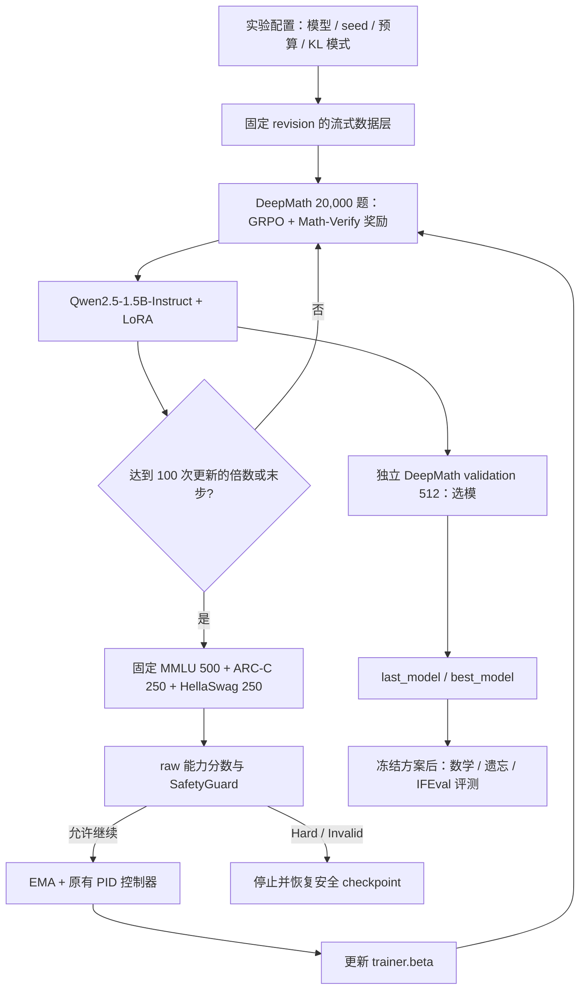

# PID-GRPO 实验架构

## 主实验数据流



控制周期为 **100 次 optimizer update**，梯度累积 micro-batch 不推进计数。
基线在 step 0 测量；step 100 算出的 beta 用于 step 101 起的损失；末步强制评测。
启动时流式读取选定样本，在内存构建训练 Dataset，适配锁定版 TRL 的重复采样和恢复。
不将 Hugging Face IterableDataset 直接交给该版本 TRL。

## 模块边界

| 层 | 位置 | 职责 |
| --- | --- | --- |
| 实验规格 | `configs/experiments/` | 三组共用模型、数据、生成预算、评测周期 |
| 阶段入口 | `scripts/run_experiment.py` | plan、freeze、preflight、train；路径及运行 seed 覆盖 |
| 数据规格 | `configs/online_benchmarks.yaml` | revision、角色、数量、采样策略、协议 |
| 流式选择 | `src/evaluation/online_data.py` | 固定抽样、角色隔离、内容哈希、manifest 验证 |
| 数据适配 | `src/data/experiment_data.py` | 载入 train/control/validation，构建 TRL chat prompt |
| 训练奖励 | `src/rewards/verified_math_reward.py` | 已批准的符号等价 0/1 奖励，旧配置不变 |
| 模型评分 | `src/evaluation/benchmark_evaluator.py` | MC 条件概率、数学验证、IFEval 规则与分项日志 |
| 更新边界 | `src/trainers/hf_control_callback.py` | optimizer update 后触发控制，记录训练与 PID 日志 |
| 控制协议 | `src/trainers/pid_grpo_trainer.py` | Guard → PID → beta → checkpoint |
| 控制器 | `src/controllers/pid_controller.py` | 原有乘性 PID 公式，未重写 |
| 训练执行 | `src/trainers/real_grpo.py` | TRL、LoRA、恢复、last/best 导出及元数据 |
| 最终评测 | `scripts/online_benchmarks.py` | base/LoRA 独立评测，显式允许使用 final/heldout |

训练 seed 影响模型采样和顺序；suite seed 决定样本成员，所有组共用。
题目只在启动时在线读取，后续控制使用相同的内存样本；manifest 校验失败则中止。
control 总分按题数加权：MMLU/ARC-C/HellaSwag 为 .5/.25/.25，并保留分项。
raw 先进入 guard，PID 只处理有效且未达到 Hard 的反馈。
复合分数不意味着每个子项都获得同样的保护；置信区间及分项 guard 是后续研究选项。

独立 DeepMath 512 题用于训练期间选模。MATH-500、GSM8K test、遗忘保留样本和 IFEval
均不参与 PID 或选模。数据身份、控制循环与最终评测相互隔离。

## 对照与恢复

主对照三个配置均设 `max_retries=0`：达到同一 Hard/Invalid 标准时恢复安全点并停止，
不改变 LR/K 后继续；早停必须报告失败和未完成预算，不能冒充同预算终态。
旧配置的回滚续训保留。如研究恢复系统，应另立消融并记录重算成本。
安全 checkpoint 保存模型/LoRA、optimizer、scheduler、TrainerState、RNG、PID 和控制状态。
当前只支持单 GPU；外部进程崩溃恢复和分布式训练未作为已验证能力。

## 运行产物

```text
<output>/<mode>/seed-42/
  run_config.json           # 实际配置
  data_manifest.json        # 样本身份，无题目正文
  baseline.json             # step 0 control 分数与分项
  metrics/training.csv      # raw / EMA / PID 项 / beta / safety
  metrics/benchmarks.jsonl  # optimizer step、角色与 benchmark 分项
  metrics/grpo.jsonl        # TRL reward、KL、生成长度等日志
  checkpoints/              # 完整安全状态
  last_model/               # 固定预算终态
  best_model/               # validation 最优模型
  model_selection.json      # 选择信息
  run_result.json           # 完成或停止状态
```

代码和单元验证不代表真实算法效果；GPU 训练、完整在线数据和评分器扩展需在服务器验收。
